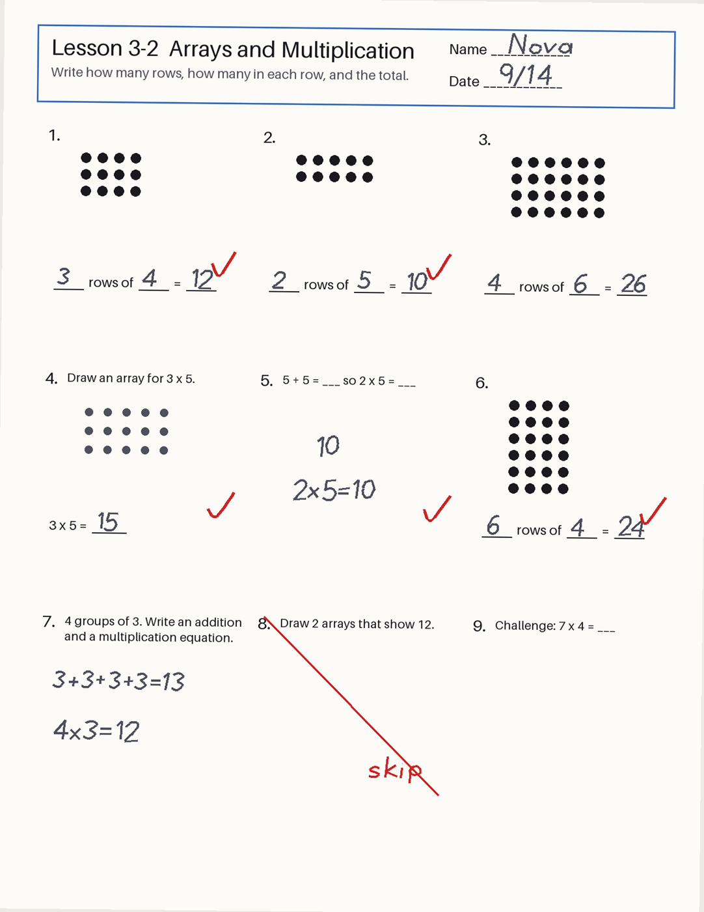
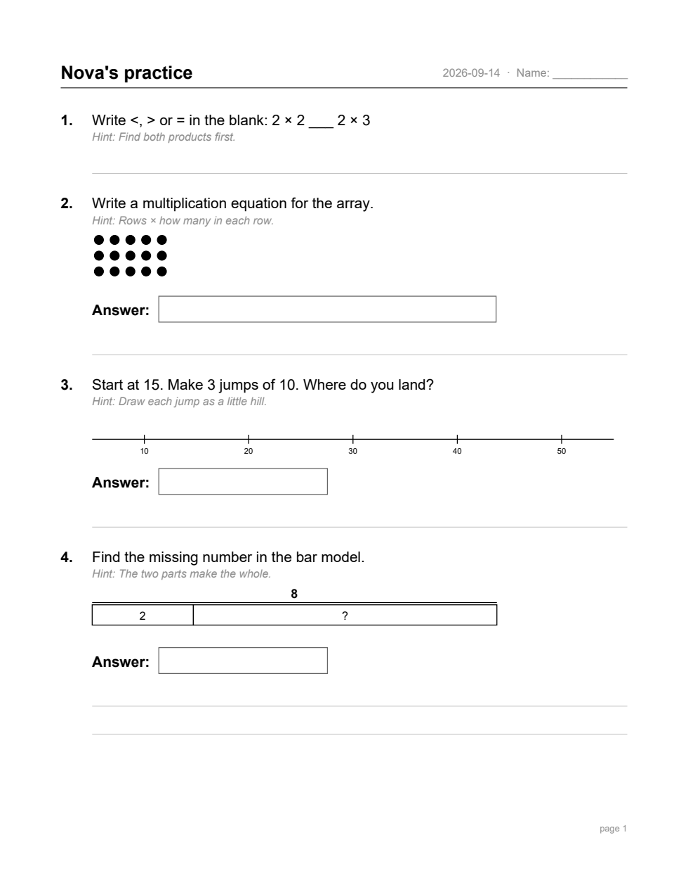
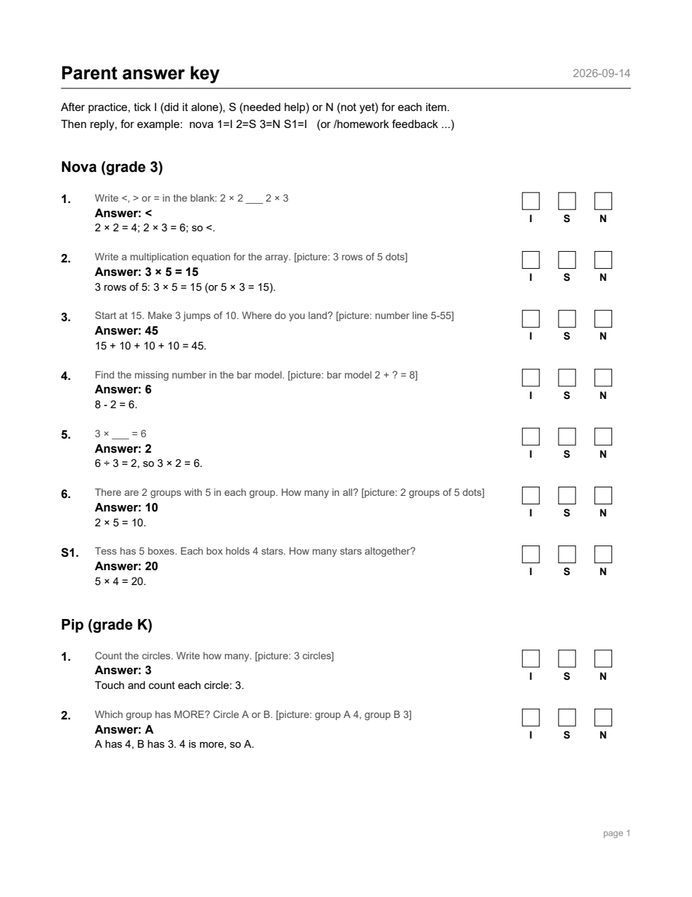
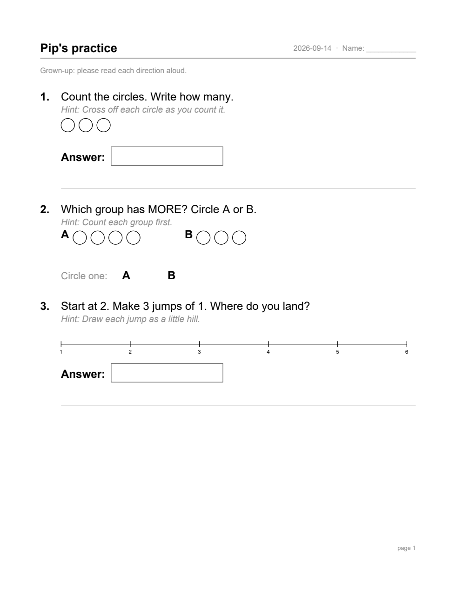
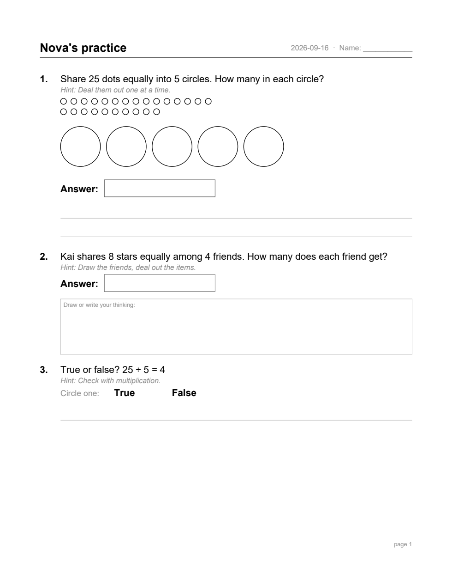

# Homework Coach (Hermes plugin)

Take a photo of your child's homework. Homework Coach notes the skill being practised,
the *format* of each task, and where your child slips. It keeps all of that in a
per-child learning brief. On the schedule you choose, it builds a short, fresh practice
packet: a printable PDF for each child plus a separate parent answer key. Rate each item
**I** (independent), **S** (supported) or **N** (not yet), and the next packet adjusts
one step at a time.

> Status: **0.1.0**. Elementary math (counting, place value, add/sub, multiplication,
> division, fractions; 31 task formats). See [SPEC.md](SPEC.md).


**Privacy:** children's data stays on your machine. The one exception is homework photos,
which go to the model provider you configure. See [PRIVACY.md](PRIVACY.md) and the
[disclosure](#what-this-plugin-does-with-your-data-disclosure) below.

### What it looks like

All of these come from the fictional demo family (`python demo/run_demo.py`). Nothing here
is a real child's work.

| Homework photo (input) | Child packet | Parent key with I/S/N boxes |
|---|---|---|
|  |  |  |

| Kindergarten packet (read-aloud) | Two days later, after feedback |
|---|---|
|  |  |

### How a packet is checked before you see it

- Every answer is recomputed from the item's printed numbers by an independent
  arithmetic checker (no `eval`), not trusted from the generator.
- Every drawn picture (dots, arrays, groups, ten frames, bars, blocks) is counted
  as it is drawn and compared with the prompt and the answer.
- Child PDFs are re-read and must contain every item and no answers or worked
  solutions; the parent key must contain every answer.
- Pages are rasterised (when `pypdfium2` is installed) and must be non-blank with
  clear margins; all text is bounds-checked while drawing.
- If any check fails, nothing is delivered as a packet: the tool returns the
  error plus a text version with a separated key.

## Install

```bash
hermes plugins install homework-coach --enable      # from the plugin catalog, once listed
# or: hermes plugins install https://github.com/andrewjsoukup/homework-coach --enable
cp examples/family.example.yaml "$HERMES_HOME/plugin-data/homework-coach/family.yaml"   # then edit
```

Family config fields are name, grade, curriculum, minutes per day and schedule; the
schema is in [`schemas/family.schema.json`](schemas/family.schema.json). To schedule
daily packets, run `/blueprint homework-coach:daily-packet` and pick a time, days and
where to deliver.

## Tools and commands

| | |
|---|---|
| `homework_coach_intake` | Analyse homework photo(s) for a child |
| `homework_coach_generate_packet` | Build + verify today's PDFs (idempotent per date) |
| `homework_coach_record_feedback` | Record I/S/N ratings, e.g. the parent's chat reply `nova 1=I 2=S S1=N` |
| `homework_coach_status` | Children, skill levels, recent packets |
| `/homework status [child]` | Status |
| `/homework packet [YYYY-MM-DD] [child...]` | Build (or re-send) a packet; replies with the PDFs attached |
| `/homework feedback <child> [YYYY-MM-DD] 1=I 2=S S1=N` | Record ratings (latest packet if no date) |
| `/homework schedule` | Print the exact `/blueprint` command(s) for your family's schedules |

## Daily packets in your chat

Homework Coach never creates cron jobs or sends messages on its own. It registers the
**`homework-coach:daily-packet`** Automation Blueprint; you schedule it like any other
blueprint, and Hermes's normal cron delivery sends the result:

1. In the chat where packets should arrive, run `/homework schedule`. It prints one
   command per distinct schedule in your family config, for example
   `/blueprint homework-coach:daily-packet time=08:30 days=1,3,5 children=pip deliver=origin`.
2. Run the printed command(s) (or pick **Daily homework practice packet** on the Desktop
   Cron page / dashboard Blueprints tab). That creates an ordinary cron job you can pause,
   edit or delete with the usual `hermes cron` tools.
3. At the scheduled time the job calls `homework_coach_generate_packet` and replies with
   one line per child plus `MEDIA:` lines; the gateway uploads the child PDFs and the
   separate parent key as native attachments (Telegram, Discord, Slack, ...).
4. After practice, reply in the same chat with one line per child:
   `nova 1=I 2=S S1=N` (I = on their own, S = with support, N = not yet). The agent records
   it with `homework_coach_record_feedback`, which says what changes in the next packet.

Behaviour you can rely on:

- **Same-day re-runs are safe.** A verified dated folder is never overwritten; re-running
  the job (or `/homework packet`) re-sends the same PDFs. Concurrent runs for one date
  serialize on a lock file, so exactly one builds.
- **Per-child schedules.** If children have different times, each job adds only its
  children's sheet and a separate key part (`parent_key-<child>.pdf`) to that day's folder;
  files already delivered are never rewritten.
- **Quiet on days off.** A scheduled run on a day no requested child is scheduled replies
  `[SILENT]`, so nothing is posted.
- **Honest failures.** If PDFs can't be produced, a scheduled run reports a cron failure
  (`[CRON_FAILURE]`) and still delivers the full problems plus a separated key as text.
- **Feedback is idempotent.** Re-sending the same reply changes nothing; a later rating for
  the same item replaces the earlier one (skill state is rebuilt from the feedback log).
  Difficulty moves at most one dimension per skill per packet.
- Keep the Hermes timezone and the family `timezone` the same: cron fires on the former,
  packet dates use the latter.

## Desktop panel

The package ships a native Hermes Desktop page (`desktop/plugin.js`) plus its backend
routes (`dashboard/plugin_api.py`, mounted at `/api/plugins/homework-coach/`). Open it from
the **Homework** sidebar row or ⌘K → *Homework Coach: Open panel*. It shows:

- each child's grade, item budget, current classroom anchor and per-skill level
  (scaffold / steps / representation / number range) with recent I/S/N tallies;
- recent packets, with buttons to save a copy of each child PDF and the parent key
  (native save dialog) or reveal the folder on a local gateway;
- **Add homework photo**: upload a JPG/PNG/WEBP/GIF/HEIC (max 20 MB) and run intake on it;
- **Rate**: an I/S/N picker per packet item that records feedback through the same tool
  the agent uses.

Both halves are opt-in, like every Desktop plugin: toggle it on in **Capabilities →
Plugins**, and the backend routes only load when `homework-coach` is in
`plugins.enabled`. The panel uses only the Desktop plugin SDK (no app internals, no
`window.hermesDesktop`).

## What this plugin does with your data (disclosure)

- **Model provider:** homework photos and text go to your **configured Hermes model
  provider** via Hermes's `ctx.llm`. If that provider is remote, your child's
  handwriting leaves your machine. You can route this to a specific model with the
  `homework_vision` auxiliary task.
- **Files read:** only the image paths you hand the intake tool, plus its own config.
  Photos uploaded through the Desktop panel are staged under
  `plugin-data/homework-coach/uploads/` and deleted after intake (the intake tool keeps
  its own copy only if `keep_source_images` is on).
- **Files written:** only under `<HERMES_HOME>/plugin-data/homework-coach/` (packets go to
  your `output_dir` if set): briefs, JSON state, feedback logs, copied photos (turn off
  with `keep_source_images: false`), packet PDFs. The full list and how to delete each
  item is in [PRIVACY.md](PRIVACY.md).
- **Not done:** no network calls of its own, no shell commands, no background
  processes, no telemetry, no credentials stored or read. A schedule only exists if you
  create the blueprint job.
- **Scheduled delivery:** a job you create from the blueprint posts the packet PDFs
  (including the parent answer key) to that job's delivery target — by default the chat you
  created it from. Anyone who can read that chat sees the packets. Disabling the plugin
  leaves existing jobs in place (Hermes keeps them); delete them with `hermes cron`.
- It does not diagnose or grade against official pacing, and it does not claim mastery
  from a single photo.

## Development

```bash
uv run --group dev pytest            # router tests also need fastapi, httpx, python-multipart
REACT_DIR=<dir with node_modules/react, react-dom> node --test tests/desktop/plugin.test.mjs
hermes plugins validate .
hermes plugins doctor . --ci
```

Regenerate the README screenshots from the demo PDFs with
`python demo/run_demo.py --out demo/out --keep` followed by `python demo/make_screenshots.py`.

All fixtures are fictional. Never commit real children's names, photos or work.

License: MIT
