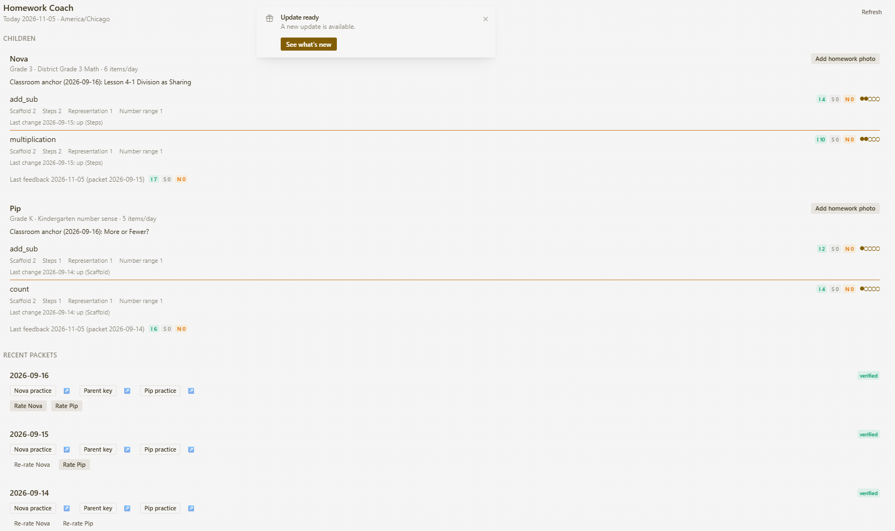

## Summary

Adds **Homework Coach 0.2.0**, a community plugin for parents. Homework photos and teacher updates help choose the classroom topic; the plugin makes checked practice PDFs and a separate parent key. Parent I/S/N feedback guides the next packet. It includes a class-plan timeline, read-back corrections, progress/history, family settings, and a daily-packet blueprint.

I own and maintain https://github.com/andrewjsoukup/homework-coach.

Source pin: `43c9b7b2dafe2d5000507b96a9f4f527b022a5e2`. This PR adds only `plugin-catalog/homework-coach.yaml`.

## Public Hermes surfaces

Seven tools; the `/homework` command; a bundled workflow skill; `homework_vision` auxiliary routing through `ctx.llm`; the user-created daily-packet automation blueprint; plugin settings/storage; Desktop SDK page, settings, status and packet cards; plugin-host backend routes. No core patches, hooks, middleware, self-updater, plugin credentials or OAuth client.

The prebuilt interface ships with its source. Native Desktop clients install the UI locally while using one backend/profile. Uploads use JSON rather than the older multipart path. Explicit Direct download supports cases where the host's general workspace file door cannot reach a generated packet. Phone-app panels are not claimed as verified.

## Data and behavior disclosures

- Homework/teacher images, extracted document text and child context go to the user's configured Hermes model provider. Normal chat tool results also enter the conversation. The plugin makes no separate third-party service or telemetry calls.
- Reads user-supplied images/material and the configured family file. Stores briefs, feedback, source copies and packets on the selected backend under profile plugin-data or configured family/output paths.
- Homework staging is removed after intake. Abandoned or failed teacher reads can leave staging copies; reviewed saves remove them. The privacy document gives the locations and cleanup guidance.
- User-triggered exports put files on the client. The research-prompt handoff can copy its prompt to the clipboard if inserting it into chat fails.
- Photo/document reads use on-demand in-process threads. Cloud use requires persistent storage and a long-lived plugin host, not stateless or round-robin multi-worker hosting.
- Scheduling is opt-in. A blueprint job shares the PDFs, including the parent key, with its selected delivery channel. Disabling the plugin does not remove those user-created jobs.
- Repository/demo families and schoolwork are fictional. The plugin does not diagnose learning conditions or claim measured learning gains.

## Verification for this exact source pin

- **Hermes admission with dependency installation: passed**, including capability registration, tool collisions, security scan (`safe`), no core override, and Desktop SDK surface checks: https://github.com/andrewjsoukup/homework-coach/actions/runs/42727802159
- **Windows, Linux and macOS component CI: passed**: https://github.com/andrewjsoukup/homework-coach/actions/runs/42727802166
- Clean public-source checkout on Windows: **246 Python tests passed**, with the Hermes framework available; **29 Node UI/transport tests passed**; shipped bundle matches source. The OS component jobs separately report three framework-only test skips when Hermes is not installed in those test environments.
- Fresh Python 3.11 environment: family setup/timezone saving, real packet generation and rasterization, and byte-exact artifact downloads passed without a system timezone database or multipart package.
- Catalog structure validated locally. The native-phone panel and a complete live remote/cloud UI session are not certified by these component tests. Previous native Desktop verification used Hermes v0.22.7.

## UI evidence

The existing screenshots use fictional data. This screenshot shows the earlier native panel layout; the 0.2.0 workspace and transport changes are in the pinned source.

- [x] One catalog YAML file only
- [x] Full public source SHA; quoted version and matching Hermes floor
- [x] Capabilities match registrations
- [x] No shipped executables/bytecode, private family data or credentials
- [x] Data/model/scheduling/background-work disclosures included
- [x] Exact-pin admission and OS checks passed
